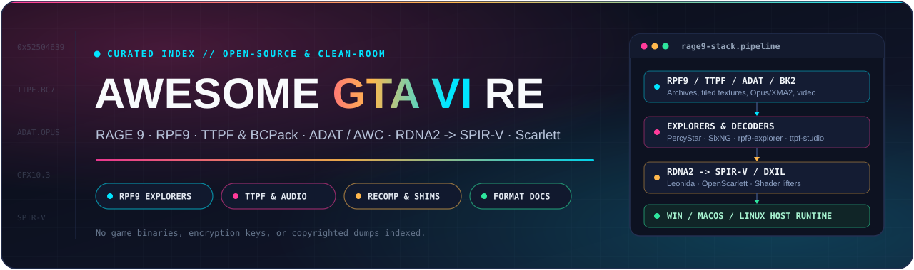
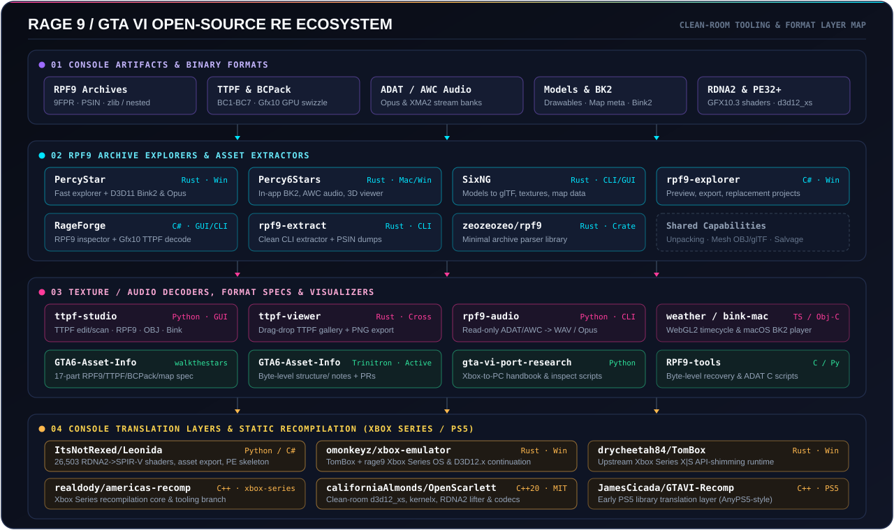

# Awesome GTA VI Reverse Engineering

**A curated index of open-source Grand Theft Auto VI (GTA 6 / GTA VI) reverse engineering tools, RAGE 9 / RPF9 archive explorers, TTPF texture and ADAT/AWC audio decoders, binary format specs, and Xbox Series (Scarlett) / PS5 translation layers.**

[Ecosystem Map](#ecosystem-overview) · [Archive Explorers](#rpf9-archive--asset-explorers) · [Textures & Audio](#texture-ttpf--audio-adat--awc-tools) · [Recomp & Shims](#console-translation-layers--static-recompilation) · [Format Docs](#format-documentation--research) · [Glossary](#format--architecture-glossary)

> [!IMPORTANT]
> **Clean-room research and open-source code only.** This list indexes reverse engineering tools, clean-room reimplementations, and format documentation. It does **not** host, link to, or endorse game executables, copyrighted assets, encryption keys, DRM bypass tools, or leaked build downloads. Every tool listed expects you to supply files from your own copy on disk.

---

## Contents

- [Ecosystem Overview](#ecosystem-overview)
- [RPF9 Archive & Asset Explorers](#rpf9-archive--asset-explorers)
- [Texture (`.ttpf`) & Audio (`ADAT` / AWC) Tools](#texture-ttpf--audio-adat--awc-tools)
- [Console Translation Layers & Static Recompilation](#console-translation-layers--static-recompilation)
- [Format Documentation & Research](#format-documentation--research)
- [Visualizers & Related Experiments](#visualizers--related-experiments)
- [Format & Architecture Glossary](#format--architecture-glossary)
- [Inclusion Criteria & Exclusions](#inclusion-criteria--exclusions)
- [Contributing](#contributing)

---

## Ecosystem Overview

Most active open-source GTA VI reverse engineering targets the Xbox Series X|S (Scarlett) RAGE 9 stack, since Xbox Series runs on x86-64 Zen 2 with RDNA2 (GFX10.3) shaders and a Windows-derived Game OS (`d3d12_xs`, `kernelx`). Early PS5 library-translation efforts exist as well.

  

---

## RPF9 Archive & Asset Explorers

Tools and libraries for inspecting, browsing, salvaging, and exporting `RPF9` containers, 3D drawables (`glTF` / `OBJ`), map placements, and embedded media.

| Project | Stack | Platform | Focus |
| :--- | :--- | :--- | :--- |
| [rpatty-dev/PercyStar](https://github.com/rpatty-dev/PercyStar) | Rust | Windows | High-speed RPF9 archive explorer with D3D11 Bink2 video playback and ADAT Opus audio decoding. |
| [Ahmet-Dedeler/Percy6Stars](https://github.com/Ahmet-Dedeler/Percy6Stars) | Rust | macOS, Windows | Cross-platform fork of PercyStar adding macOS support, in-app BK2 video, AWC audio previews, and 3D model browsing. |
| [holdmysocks/SixNG](https://github.com/holdmysocks/SixNG) | Rust | Cross-platform (CLI + GUI) | Asset extractor for GTA VI Xbox Series `RPF9` archives. Exports models to `glTF`, textures, and map data (`GPL-3.0`). |
| [breadbbbb/rpf9-explorer](https://github.com/breadbbbb/rpf9-explorer) | C# | Windows | RPF9 archive browser with model, texture, audio, and video previews, asset export, and saved replacement projects (used as a submodule by `Leonida`). |
| [offs/rpf9-extract](https://github.com/offs/rpf9-extract) | Rust | Cross-platform (CLI) | Clean-room CLI extractor and inspector (`-n` list, `-v` header fields and PSIN tables). |
| [nullbrik/RageForge](https://github.com/nullbrik/RageForge) | C# | Windows (GUI + CLI) | RPF9 archive inspector (entry counts, types, verification hashes) paired with a live `.ttpf` texture decoder (Gfx10 detiling + BC1-BC7). |
| [zeozeozeo/rpf9](https://github.com/zeozeozeo/rpf9) | Rust | Library crate | Minimal clean-room Rust library implementing the `RPF9` archive format with runnable `examples/`. |

---

## Texture (`.ttpf`) & Audio (`ADAT` / AWC) Tools

Focused decoders for RAGE 9 GPU-tiled texture packs (`.ttpf`, `BCPack`, `Gfx10` swizzling) and audio containers (`ADAT` / `AWC` Opus and `XMA2` banks).

| Project | Stack | Platform | Focus |
| :--- | :--- | :--- | :--- |
| [woreksami/ttpf-studio](https://github.com/woreksami/ttpf-studio) | Python | Cross-platform (GUI) | View, export, and replace `.ttpf` textures (BC1-BC7, RGBA8/BGRA8/RGBA16F, GPU unswizzling, headerless scan recovery), recover RPF9 files, export models to OBJ, and play Bink video. |
| [paryzius/ttpf-viewer](https://github.com/paryzius/ttpf-viewer) | Rust | Windows, macOS, Linux | Standalone drag-and-drop `.ttpf` gallery inspecting formats, dimensions, mip chains, and GPU tile layouts with batch PNG export. |
| [jaylikesbunda/rpf9-audio](https://github.com/jaylikesbunda/rpf9-audio) | Python | Cross-platform (CLI) | Dependency-free, read-only RPF9 and `ADAT`/AWC audio research toolkit. Extracts Opus packets, decodes to WAV, and remuxes playable Ogg Opus. |

---

## Console Translation Layers & Static Recompilation

Projects translating Xbox Series X|S (`Scarlett`) or PS5 system libraries, memory models, and RDNA2 shaders so console binaries can run natively on PC. Note that GTA VI itself does **not** boot in any open-source project yet.

| Project | Stack | Target | Focus & Current Status |
| :--- | :--- | :--- | :--- |
| [ItsNotRexed/Leonida](https://github.com/ItsNotRexed/Leonida) | Python, C# | Xbox Series -> Windows (Vulkan) | Static recompilation effort for build `1.0.2.1`. Translates all 26,503 RDNA2 shaders to SPIR-V passing `spirv-val`, exports OBJ models / DDS textures / AWC banks, and includes an untested PE loader skeleton. Xbox D3D12 -> Vulkan and booting are not done yet. |
| [omonkeyz/xbox-emulator](https://github.com/omonkeyz/xbox-emulator) | Rust | Xbox Series X\|S -> Windows | Active continuation of `TomBox` (`TomBox + rage9`). Reimplements `d3d12_xs`, RDNA2 shader translation, unified memory aliasing, and console OS DLLs, with automated per-function progress maps. |
| [drycheetah84/TomBox](https://github.com/drycheetah84/TomBox) | Rust | Xbox Series X\|S -> Windows | Upstream Xbox Series X\|S API-shimming emulator that `omonkeyz/xbox-emulator` builds upon. |
| [realdody/americas-recomp (`xbox-series`)](https://github.com/realdody/americas-recomp/tree/xbox-series) | C++ | Xbox Series -> PC | Recompilation runtime (`core/`, `tools/`, `docs/`). Make sure to check the `xbox-series` branch (`main` only holds `LICENSE`). |
| [californiaAlmonds/OpenScarlett](https://github.com/californiaAlmonds/OpenScarlett) | C++20 (`MIT`) | Xbox Series X\|S -> Windows | Clean-room Scarlett translation layer with PE32+ APC hook loader, `d3d12_xs` COM proxy, `xg_xs` swizzling, `kernelx` memory aliasing, RDNA2 -> SPIR-V/DXIL lifter, GDeflate/BCPack/XMA2/Bink2 codecs, and GDK shims. |
| [JamesCicada/GTAVI-Recomp](https://github.com/JamesCicada/GTAVI-Recomp) | C++ | PS5 -> PC | Early AnyPS5-style library translation layer. Build system, core primitives, and diagnostic tests are in place; PS5 system libraries are not implemented yet. |

---

## Format Documentation & Research

Byte-level specifications, field confidence tables, and reproducible inspection scripts reverse engineered from local file headers and decoded outputs.

| Project | Focus | Notes |
| :--- | :--- | :--- |
| [walkthestars/GTA6-Asset-Info](https://github.com/walkthestars/GTA6-Asset-Info) | 17-part asset format spec + SixNG guide | Covers `RPF9`, resources/pages, texture dictionaries, Xbox tiling, `ttpf`, `BCPack`, models, map meta, placements, interiors, vehicle paint, materials, collision, navmesh, lights, road graphs, PSO/RBF/BVH4/AWC. |
| [TrinitronClient/GTA6-Asset-Info](https://github.com/TrinitronClient/GTA6-Asset-Info) | Active continuation with `structure/` byte specs | Adds raw byte-level `structure/00-06` references plus community PRs (TTPF array/cubemap layouts, codec type byte mapping, AWC/ADAT notes). |
| [oguzhanozfe/gta-vi-port-research](https://github.com/oguzhanozfe/gta-vi-port-research) | Xbox-to-PC research handbook | Markdown format documentation and reproducible Python file-inspection scripts in `tools/`. |
| [frenzy42069/RPF9-tools](https://github.com/frenzy42069/RPF9-tools) | Byte-level `format_desc.md` + C/Python scripts | Detailed `RPF9` container geometry, PSIN checks, Bink2 range carving, and `ADAT` Opus extraction (`rpf9_extract_audio.c`). Ignore the satirical disclaimer in the README. |

---

## Visualizers & Related Experiments

Standalone graphics and media tools built alongside GTA VI / RPF9 format exploration.

- [Ahmet-Dedeler/weather-study](https://github.com/Ahmet-Dedeler/weather-study) (`TypeScript / WebGL2`) - Open-source WebGL2 weather engine and timecycle visualizer with volumetric clouds, ocean reflections, branching lightning, and 4K capture, inspired by RPF9 research.
- [Ahmet-Dedeler/bink-player-mac](https://github.com/Ahmet-Dedeler/bink-player-mac) (`Objective-C / macOS`) - Native macOS Bink2 (`.bk2`) video player built alongside PercyStar and RPF9 exploration.

---

## Format & Architecture Glossary

Quick reference for terms that show up across these repositories:

| Term | Meaning |
| :--- | :--- |
| `RPF9` | Rockstar Package File v9 (`9FPR` / `0x52504639`). Next-generation archive container used by GTA VI / RAGE 9, supporting nested RPFs, PSIN tables, and zlib/BCPack payloads. |
| `TTPF` | RAGE 9 texture store format holding mipmapped GPU-swizzled surfaces (`BC1`-`BC7`, `RGBA8`, `RGBA16F`, texture arrays, cubemaps). |
| `BCPack` | Block-compression stream format used on Xbox Series X\|S alongside GDeflate to compress GPU textures and resource pages. |
| `ADAT` / `AWC` | Rockstar audio bank containers storing multi-stream `Opus` and `XMA2` voice, SFX, and radio assets. |
| `BK2` (Bink 2) | RAD Game Tools video codec used in `movies.rpf` reels and UI cutscenes. |
| `RDNA2` (`GFX10.3`) | AMD GPU ISA used by Xbox Series X\|S and PS5. Tools like `Leonida` and `OpenScarlett` lift precompiled RDNA2 shader binaries to `SPIR-V` (Vulkan) or `DXIL` (D3D12). |
| `Scarlett` / `d3d12_xs` | Microsoft codename for Xbox Series X\|S and its console-extended Direct3D 12 + `kernelx` runtime shimmed on Windows by `OpenScarlett` and `xbox-emulator`. |

---

## Inclusion Criteria & Exclusions

To keep this directory useful and safe, projects are audited before being added:

- **Included:** Real working code, libraries, format specs, or active runtime/translation research backed by actual commits.
- **Excluded:** Empty placeholder repos (0 commits / empty tree), raw extracted copyrighted game strings or assets, decryption keys, cheat-code / wallpaper hubs, `make.fun` bounty/meme repos, and clickbait "100% playable GTA 6 PC port" or malware-bait repositories.

---

## Contributing

Know an open-source RAGE 9 / RPF9 / GTA VI reverse engineering tool, library, or format writeup that belongs here?

1. Check [CONTRIBUTING.md](CONTRIBUTING.md) to verify clean-room compliance and format guidelines.
2. Open a pull request or [submit a project via the issue form](.github/ISSUE_TEMPLATE/submit-project.yml).

## License

To the extent possible under law, contributors have waived all copyright and related or neighboring rights to this curated list under [CC0 1.0 Universal](LICENSE). Linked projects remain under their respective licenses.
